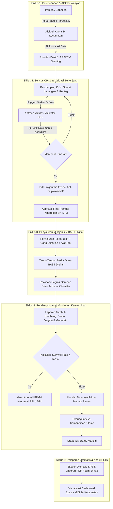

# DOKUMEN PROFIL INOVASI DAERAH
## GEMASMART (SIBIBIT)
### Sistem Informasi Manajemen Bantuan Bibit, Pendampingan Lapangan, dan Monitoring Kemandirian Pangan Keluarga Binaan Kabupaten Sumbawa

---

| Parameter | Keterangan |
| :--- | :--- |
| **Nama Inovasi** | **GEMASMART (SIBIBIT)** |
| **Nama Lengkap Sistem** | Sistem Informasi Manajemen Bantuan Bibit, Pendampingan Lapangan, dan Monitoring Kemandirian Pangan Keluarga Binaan Kabupaten Sumbawa |
| **Inisiator Inovasi** | Bappeda Kabupaten Sumbawa & Dinas Pertanian / Ketahanan Pangan Kab. Sumbawa berkolaborasi dengan Perguruan Tinggi Mitra (Universitas Teknologi Sumbawa - UTS / Forum Perguruan Tinggi) |
| **Jenis Inovasi** | Inovasi Tata Kelola Pemerintahan & Inovasi Pelayanan Publik Daerah |
| **Bentuk Inovasi** | Inovasi Daerah Berbasis Digital *(Web & Mobile Integrated Platform)* |
| **Tahapan Inovasi** | Penerapan *(Full Implementation)* |
| **Urusan Pemerintahan** | Urusan Wajib Non-Pelayanan Dasar (Pangan, Pertanian, Sosial) & Prioritas Nasional (Pengentasan Kemiskinan Ekstrem & Percepatan Penurunan Stunting) |
| **Tahun Inisiasi / Uji Coba** | 2025 |
| **Tahun Penerapan** | 2026 |
| **Cakupan Wilayah** | 24 Kecamatan di Kabupaten Sumbawa |
| **Target Sasaran** | Keluarga Penerima Manfaat (KPM) / Rumah Tangga Desil 1–3 P3KE & Lokus Prioritas Stunting |

---

## 1. RINGKASAN EKSEKUTIF *(EXECUTIVE SUMMARY)*

**GEMASMART (SIBIBIT)** adalah inovasi tata kelola pemerintahan dan pelayanan publik digital yang mentransformasikan model penyaluran bantuan pertanian di Kabupaten Sumbawa. Berbeda secara fundamental dengan program bantuan pertanian konvensional yang menyasar kelompok tani (poktan) tanpa pengawalan intensif, GemaSmart mengadopsi pendekatan **Keluarga Penerima Manfaat (KPM / KK Binaan)** berbasis data mikro kemiskinan ekstrem (*Pensasaran Percepatan Penghapusan Kemiskinan Ekstrem / P3KE*) dan lokus percepatan penurunan stunting.

Inovasi ini mengintegrasikan ekosistem **Quadruple Helix** yang menyatukan Pemerintah Daerah (Bappeda & Dinas Pertanian), Perguruan Tinggi (LPPM, Dosen Pembimbing Lapangan/DPL, dan Mahasiswa KKN-Tematik/PPL), Keluarga Sasaran, serta teknologi informasi mutakhir. Melalui platform ini, bantuan tidak hanya berupa paket bibit unggul hortikultura/pangan, melainkan dipadukan secara komprehensif dengan bantuan modal usaha stimulan dan sarana produksi pertanian. 

Seluruh alur dikawal secara berjenjang melalui **5 siklus**: (1) Penetapan kuota wilayah terpadu desil, (2) Sensus faktual Calon Petani Calon Lokasi (CPCL) ber-geotagging oleh surveyor/pendamping yang divalidasi oleh akademisi independen (DPL/Validator) dan disahkan Pemda, (3) Penyaluran dengan Berita Acara Serah Terima digital, (4) Pendampingan berkala disertai pemantauan kelangsungan tumbuh (*survival rate*) dan skoring indeks kemandirian pangan, hingga (5) Penerbitan Laporan Pertanggungjawaban (SPJ) otomatis, pemetaan geospasial GIS se-Kabupaten Sumbawa, dan graduasi keluarga binaan menjadi mandiri.

Inovasi ini dilengkapi **Algoritma Deteksi Dini & Integritas Sistem (FR-24)** yang secara otomatis mengidentifikasi duplikasi NIK, anomali penurunan *survival rate* tanaman di bawah 50%, serta keterlambatan pelaporan di lapangan, mewujudkan akuntabilitas bantuan publik yang transparan, bebas fraud, dan berdampak nyata terhadap peningkatan kesejahteraan masyarakat.

---

## 2. LATAR BELAKANG & ANALISIS PERMASALAHAN

### 2.1. Isu Strategis Daerah & Permasalahan Riil
Pemerintah Kabupaten Sumbawa dihadapkan pada dua tantangan pembangunan manusia yang mendesak:
1. **Tingginya Angka Kemiskinan Ekstrem & Kerentanan Pangan Rumah Tangga**: Masih terkonsentrasinya keluarga prasejahtera pada Desil 1 sampai Desil 3 data P3KE yang rentan terhadap guncangan harga komoditas pangan pokok (cabai, bawang, sayuran, jagung, dan beras).
2. **Urgensi Penurunan Angka Prevalensi Stunting**: Pemenuhan asupan gizi seimbang balita dan ibu hamil sangat bergantung pada ketersediaan pangan bergizi yang terjangkau di tingkat pekarangan keluarga.

### 2.2. Kelemahan Model Bantuan Pertanian Konvensional *(Baseline)*
Sebelum hadirnya inovasi GemaSmart (SiBibit), penyaluran bantuan pertanian di daerah menghadapi berbagai kelemahan struktural:
* **Elitisme Kelompok Tani (Poktan)**: Bantuan biasanya diserahkan kepada ketua atau pengurus kelompok tani. Keluarga paling miskin dan rentan yang tidak memiliki lahan luas kerap terpinggirkan (*exclusion error*).
* **Fenomena "Bagi Bibit Lalu Ditinggal" (*Drop and Forget*)**: Bibit diserahkan tanpa pendampingan budidaya pasca-salur. Akibatnya, tingkat kematian bibit (*mortality rate*) sangat tinggi karena kekeringan, serangan hama, atau tidak dirawat.
* **Tumpang Tindih Penerima Manfaat (*Inclusion Error*)**: Ketiadaan database tunggal dan verifikasi faktual lapangan bergeotagging menyebabkan adanya oknum penerima ganda (NIK ganda terdaftar di lintas kelompok/desa).
* **Birokrasi Pelaporan & SPJ yang Manual, Lambat, dan Berisiko Maladministrasi**: Penyusunan dokumen pertanggungjawaban fisik memakan waktu berbulan-bulan, memperlambat serapan anggaran dan membebani aparatur dinas.
* **Ketiadaan Pengukuran Dampak (*Outcome Measurement*)**: Tidak ada indikator yang memantau apakah setelah menerima bantuan, ekonomi keluarga tersebut meningkat atau sudah mandiri secara pangan.

### 2.3. Landasan Hukum & Kebijakan
1. **Undang-Undang Nomor 23 Tahun 2014** tentang Pemerintahan Daerah.
2. **Peraturan Pemerintah Nomor 38 Tahun 2017** tentang Inovasi Daerah.
3. **Instruksi Presiden Nomor 4 Tahun 2022** tentang Percepatan Penghapusan Kemiskinan Ekstrem.
4. **Peraturan Presiden Nomor 72 Tahun 2021** tentang Percepatan Penurunan Stunting.
5. **Peraturan Menteri Dalam Negeri Nomor 104 Tahun 2018** tentang Penilaian dan Pemberian Penghargaan dan/atau Insentif Inovasi Daerah.
6. **Rencana Pembangunan Jangka Menengah Daerah (RPJMD) Kabupaten Sumbawa** terkait Visi Sumbawa Gemilang Berkeadaban, peningkatan ketahanan pangan, dan perlindungan sosial terpadu.

---

## 3. RANCANG BANGUN & NOVELTI (KEBARUAN INOVASI)

### 3.1. Gagasan / Ide Inovatif
GemaSmart (SiBibit) mendobrak sekat birokrasi konvensional dengan memadukan **Intervensi Kebijakan Fiskal Daerah + Pemberdayaan Tri Dharma Perguruan Tinggi + Transformasi Digital Berbasis Spasial**.

```
[ BAPPEDA & PEMDA SUMBAWA ]  ---> Penetapan Kuota & Pagu Anggaran Berbasis Desil P3KE
           │
           ▼
[ PERGURUAN TINGGI MITRA ]  ---> DPL (Validator) & Mahasiswa KKN-Tematik (Pendamping)
           │
           ▼
[ VERIFIKASI FAKTUAL GEOTAG ] ---> Sensus Lapangan NIK Dukcapil & Titik Koordinat Pekarangan
           │
           ▼
[ PENYALURAN MULTI-KOMPONEN ] ---> Bibit Hortikultura + Bantuan Modal Usaha + Sarana Tani
           │
           ▼
[ MONITORING & SURVIVAL RATE ] ---> Deteksi Dini Anomali FR-24 + Skoring Indeks Kemandirian
           │
           ▼
[ GRADUASI KELUARGA MANDIRI ] ---> KPM Lolos Kemiskinan Ekstrem + SPJ & Laporan Eksekutif Otomatis
```

### 3.2. Enam Pilar Kebaruan *(Novelty)* GemaSmart (SiBibit)
1. **Peralihan Paradigma Sasaran: Dari Kelompok Tani ke Keluarga Binaan (KPM)**:
   Intervensi difokuskan langsung pada unit terkecil masyarakat (rumah tangga) yang berstatus Desil 1–3 P3KE untuk menjamin keadilan distributif.
2. **Sinergi Independen Kampus-Pemda *(Quadruple Helix Synergy)*:
   Keterlibatan Dosen Pembimbing Lapangan (DPL) sebagai Validator independen dan Mahasiswa KKN Tematik/PPL sebagai Pendamping meminimalisir intervensi politis serta memastikan keabsahan data lapangan secara ilmiah dan objektif.
3. **Validasi Geospasial Berlapis (*Geotagging & Multi-Tier Verification*)**:
   Setiap berkas pendaftaran dilengkapi koordinat presisi lahan, foto faktual kondisi rumah tangga, nomor identitas kependudukan terverifikasi, dan melewati 3 lapis persetujuan: Surveyor -> Validator Kampus -> Approval Final Pemda.
4. **Deteksi Dini Integritas & Anomali Sistem (Algoritma FR-24)**:
   Sistem secara otomatis mendeteksi anomali jika tingkat kelangsungan hidup bibit (*survival rate*) turun di bawah ambang batas toleransi (50%) atau terjadi keterlambatan pelaporan berkala, memicu notifikasi siaga (*early warning*) agar Petugas Penyuluh Lapangan segera turun melakukan proteksi tanaman.
5. **Instrumen Skoring Indeks Kemandirian Keluarga**:
   Memantau evolusi keluarga binaan melalui 3 pilar: (a) Pengurangan pengeluaran belanja pangan harian melalui konsumsi mandiri, (b) Peningkatan pendapatan dari penjualan surplus hasil panen dan usaha olahan, serta (c) Partisipasi sosial ekonomi komunitas, hingga KPM dinyatakan tergraduasi (Mandiri).
6. **Digitalisasi SPJ & Laporan Eksekutif Sekali Klik (*Single-Click Reporting*)**:
   Mengeliminasi tumpukan kertas administratif dengan menerbitkan format Laporan Penyaluran, SPJ Dana Bappeda, dan Berita Acara Serah Terima (BAST) berstandar resmi kedinasan dalam format PDF terenkripsi secara otomatis.

---

## 4. STRUKTUR AKTOR & PEMBAGIAN PERAN SISTEM (RBAC)

Sistem dirancang dengan arsitektur hak akses ketat (*Role-Based Access Control*) yang membagi tata kelola ke dalam 5 entitas:

| No | Peran Pengguna | Aktor Institusional | Tanggung Jawab & Wewenang Kunci |
| :---: | :--- | :--- | :--- |
| **1** | **Pemerintah Daerah (Pemda)** | Bappeda & Dinas Pertanian / Ketahanan Pangan Kab. Sumbawa | Menetapkan kuota anggaran dan target KK per 24 kecamatan; menyetujui pengesahan CPCL final; memantau Dashboard GIS Spasial; mengawasi serapan dana hibah kampus; dan memantau log audit FR-24. |
| **2** | **Kampus Mitra** | LPPM / Koordinator DPL (Perguruan Tinggi) | Mengelola pagu dana Bappeda; menyusun katalog program bantuan; menugaskan validator dan pendamping ke wilayah sasaran; serta mengesahkan rekapitulasi SPJ dan log pendampingan resmi. |
| **3** | **Validator Kampus** | Dosen Pembimbing Lapangan (DPL) | Memeriksa berkas survei CPCL yang masuk dalam antrean digital; melakukan uji petik kelayakan dokumen dan titik koordinat; serta memberikan rekomendasi setuju/tolak/revisi. |
| **4** | **Pendamping Lapangan** | Mahasiswa KKN-Tematik / PPL / Penyuluh Pertanian | Melakukan sensus *door-to-door*; mengambil data geospasial dan foto pekarangan; mendampingi distribusi bantuan; memantau tumbuh kembang bibit secara berkala; serta menginput penilaian kemandirian. |
| **5** | **Keluarga Penerima (KPM)** | Kepala Keluarga / Anggota Rumah Tangga Binaan | Menerima paket bantuan; mengakses portal mandiri untuk melaporkan perkembangan tanaman; dan menyampaikan kendala lapangan (hama/pupuk/air) secara langsung ke sistem. |

---

## 5. TAHAPAN ALUR KERJA SISTEM (5 SIKLUS OPERASIONAL)



### Penjelasan Rinci Siklus:
1. **Siklus 1 (Perencanaan & Alokasi Kuota)**:
   Pemda mendistribusikan pagu anggaran program bantuan dan membagi alokasi bibit/bantuan ke 24 kecamatan berdasarkan indeks kerentanan pangan dan konsentrasi desil kemiskinan ekstrem.
2. **Siklus 2 (Sensus CPCL & Validasi Berjenjang)**:
   Pendamping lapangan melakukan *ground-checking* langsung ke rumah warga, mencocokkan NIK, luas pekarangan produktif, kesiapan sumber air, dan mengambil foto geotagging. Validator DPL memeriksa berkas sebelum diajukan ke Pemda. Mesin sistem mengecek riwayat NIK untuk menjamin tidak ada penerima ganda.
3. **Siklus 3 (Penyaluran Bantuan Terpadu)**:
   Bantuan didistribusikan tepat waktu sesuai musim tanam, mencakup bibit hortikultura (cabai, bawang merah, sayuran), bibit tanaman pangan (jagung hibrida, padi gogo), stimulan tunai usaha tani, serta sarana produksi (alat semprot elektrik, pupuk organik hayati, dsb.). Penyaluran langsung terekam pada BAST digital.
4. **Siklus 4 (Monitoring Kelangsungan Tumbuh & Kemandirian)**:
   Setiap 2–4 minggu, kondisi tanaman di pekarangan dipantau. Algoritma otomatis menghitung *survival rate*. Apabila terdapat kematian bibit di atas 50%, sistem memunculkan penanda anomali agar penyuluh dan mahasiswa pendamping dapat melakukan perlakuan khusus. Pada akhir siklus budidaya, keluarga dinilai kemandiriannya.
5. **Siklus 5 (Akuntabilitas SPJ & Evaluasi Spasial GIS)**:
   Kampus dan Pemda dapat mengunduh seluruh dokumen pertanggungjawaban keuangan, bukti salur, dan log pendampingan dalam format PDF resmi tanpa perlu rekap manual berhari-hari. Peta GIS interaktif menyajikan visualisasi sebaran wilayah berstatus Hijau (Aman/Mandiri), Kuning (Perhatian), dan Merah (Anomali).

---

## 6. TUJUAN INOVASI

### 6.1. Tujuan Jangka Pendek (0–6 Bulan)
* Membangun basis data tunggal (*single source of truth*) calon penerima manfaat bantuan bibit dan pemberdayaan pangan keluarga di Kabupaten Sumbawa yang terintegrasi NIK dan berkoordinat spasial.
* Menghilangkan 100% kasus duplikasi penerima bantuan (*zero duplicate records*) melalui filter integritas sistem FR-24.
* Memangkas waktu verifikasi lapangan dan penerbitan Surat Keputusan CPCL dari 30 hari menjadi kurang dari 7 hari kerja.

### 6.2. Tujuan Jangka Menengah (6–18 Bulan)
* Meningkatkan angka kelangsungan hidup bibit bantuan (*survival rate*) dari rata-rata < 40% (pola konvensional) menjadi di atas 85% melalui pendampingan mahasiswa KKN-Tematik dan sistem peringatan dini anomali.
* Mengurangi beban pengeluaran pangan harian keluarga sasaran (Desil 1–3) minimal 20–30% melalui pemanfaatan pekarangan pangan lestari mandiri.
* Menjamin transparansi dan akuntabilitas 100% realisasi dana hibah Bappeda kepada perguruan tinggi mitra dengan penerbitan SPJ digital tepat waktu.

### 6.3. Tujuan Jangka Panjang (> 18 Bulan)
* Mendorong graduasi keluarga penerima manfaat keluar dari jerat kemiskinan ekstrem menuju status **Mandiri** secara berkelanjutan.
* Berkontribusi nyata terhadap penurunan angka prevalensi stunting di lokus-lokus prioritas Kabupaten Sumbawa melalui ketersediaan pangan bergizi segar di pekarangan rumah tangga.
* Menjadikan Kabupaten Sumbawa sebagai percontohan nasional (*role model*) dalam tata kelola bantuan sosial-pertanian kolaboratif berbasis digital.

---

## 7. MANFAAT INOVASI

```
                                 MANFAAT INOVASI
                                 GEMASMART (SIBIBIT)
                                         │
        ┌────────────────────────────────┼────────────────────────────────┐
        ▼                                ▼                                ▼
  PEMERINTAH DAERAH             PERGURUAN TINGGI                 KELUARGA SASARAN
 (Bappeda & Dinas)               (Kampus Mitra)                   (Masyarakat)
 • Efisiensi APBD                • Wadah Tri Dharma Nyata         • Akses pangan bergizi
 • Zero fraud & no duplicate     • KKN Tematik Berdampak          • Hemat pengeluaran harian
 • Dashboard GIS real-time       • Publikasi ilmiah & riset       • Tambahan pendapatan panen
 • SPJ cepat & audit-proof       • Rekognisi MBKM mahasiswa       • Tergraduasi jadi Mandiri
```

### 7.1. Manfaat bagi Pemerintah Daerah (Pemda Sumbawa & Bappeda)
1. **Efektivitas Alokasi Anggaran**: Dana hibah APBD/Bappeda tersalurkan dengan akurasi target maksimal (*high targeting precision*), tepat sasaran pada keluarga Desil 1–3 P3KE.
2. **Mitigasi Risiko Hukum & Fraud**: Algoritma audit FR-24 dan keterlibatan akademisi membebaskan aparatur dari potensi temuan maladministrasi oleh BPK/Inspektorat.
3. **Pengambilan Kebijakan Berbasis Bukti (*Evidence-Based Policy*)**: Pimpinan daerah memperoleh visibilitas instan atas status ketahanan pangan di 24 kecamatan melalui visualisasi spasial GIS interaktif.

### 7.2. Manfaat bagi Perguruan Tinggi Mitra (Kampus & Akademisi)
1. **Implementasi Nyata Tri Dharma Perguruan Tinggi**: Riset terapan dan pengabdian kepada masyarakat terintegrasi langsung dengan program strategis pemerintah daerah.
2. **Optimalisasi Program KKN Tematik & MBKM**: Mahasiswa mendapatkan pengalaman belajar lapangan yang terstruktur dengan indikator capaian kinerja yang terukur secara digital.
3. **Penyusunan SPJ yang Rapi dan Transparan**: Pengelolaan dana bantuan kampus terekam secara otomatis, memudahkan pelaporan pertanggungjawaban administratif.

### 7.3. Manfaat bagi Keluarga Penerima Manfaat (KPM / Warga)
1. **Peningkatan Ketahanan Pangan Rumah Tangga**: Keluarga memiliki kebun gizi mandiri di pekarangan rumah untuk memenuhi kebutuhan sayur, cabai, dan pangan sehat keluarga.
2. **Peningkatan Pendapatan Ekonomi Keluarga**: Penjualan surplus panen bibit hortikultura dan usaha olahan binaan memberikan aliran pendapatan baru bagi ibu rumah tangga.
3. **Kepastian Pendampingan**: Penerima tidak dibiarkan sendiri; mereka mendapatkan bimbingan teknis intensif dari mahasiswa dan penyuluh hingga berhasil panen.

---

## 8. HASIL DAN DAMPAK INOVASI (SEBELUM VS SESUDAH)

| Indikator Evaluasi | Kondisi Sebelum Inovasi (Pola Konvensional) | Kondisi Setelah Inovasi GEMASMART (SIBIBIT) |
| :--- | :--- | :--- |
| **Unit Sasaran Bantuan** | Berbasis Kelompok Tani (Poktan), sering kali hanya dinikmati segelintir elite kelompok | Berbasis Rumah Tangga / Keluarga Penerima Manfaat (KPM) terverifikasi Desil 1–3 P3KE |
| **Akurasi Data Penerima** | Rawan data ganda, titipan, atau fiktif; tidak ada koordinat rumah tangga | Terverifikasi NIK Dukcapil, koordinat geotagging presisi, dan uji petik oleh Validator DPL |
| **Tingkat Kelangsungan Hidup Tanaman (*Survival Rate*)** | Sangat rendah (< 35–40%), banyak bibit mati atau terbuang sia-sia tanpa pengawasan | Terjaga tinggi (> 85%) dengan pelaporan fase tumbuh dan sistem peringatan dini anomali FR-24 |
| **Keberlanjutan Pasca Salur** | Tidak ada evaluasi kemandirian; program selesai saat barang diserahterimakan | Evaluasi bertahap menggunakan Skoring Indeks Kemandirian hingga status KPM 'Mandiri' |
| **Waktu Pemrosesan Administrasi & SPJ** | Membutuhkan waktu 30–60 hari kerja dengan tumpukan berkas fisik yang rawan hilang | Selesai dalam hitungan menit (otomatisasi PDF) dan terarsip digital secara aman |
| **Kolaborasi Antar-Lembaga** | Berjalan secara silo (Dinas Pertanian bekerja sendiri tanpa melibatkan kampus) | Kolaborasi Quadruple Helix yang solid (Pemda Sumbawa + UTS/Kampus + Mahasiswa + Warga) |
| **Pemantauan Pimpinan Daerah** | Menunggu laporan akhir tahun yang bersifat statis dan retrospektif | Dashboard eksekutif real-time dengan peta spasial interaktif 24 kecamatan |

---

## 9. SKALABILITAS, REPLIKABILITAS, & KEBERLANJUTAN (*SUSTAINABILITY*)

### 9.1. Keberlanjutan Regulasi & Kebijakan
Inovasi didukung oleh komitmen regulasi Pemerintah Kabupaten Sumbawa melalui Keputusan Bupati mengenai penetapan penerima program bantuan kemandirian pangan, perjanjian kerja sama (MoU & PKS) formal antara Pemda dengan Universitas Teknologi Sumbawa (UTS) dan perguruan tinggi lainnya, serta integrasi dalam dokumen perencanaan RPJMD/RKPD.

### 9.2. Keberlanjutan Anggaran & Finansial
* Pembiayaan inovasi dijamin melalui pos program prioritas Bappeda dan Dinas Pertanian pada Anggaran Pendapatan dan Belanja Daerah (APBD) Kabupaten Sumbawa.
* Efisiensi pemangkasan biaya survei pihak ketiga melalui pemanfaatan program KKN Tematik mahasiswa menjadikan inovasi ini memiliki efisiensi biaya (*cost-effective*) yang sangat tinggi.

### 9.3. Keberlanjutan Sumber Daya Manusia (SDM)
Setiap semester, kampus mitra secara berkesinambungan menerjunkan mahasiswa KKN Tematik baru yang telah dibekali modul pelatihan (*briefing/bimtek*) penggunaan aplikasi GemaSmart, menjamin ketersediaan tenaga pendamping lapangan yang tak pernah putus tanpa membebani penambahan aparatur sipil negara.

### 9.4. Potensi Replikasi (*Replicability*)
Arsitektur sistem dibangun di atas fondasi teknologi web modern (Laravel PHP, RESTful API, responsif desktop/mobile) dengan struktur database modular. Model intervensi bantuan berbasis keluarga prasejahtera yang didampingi perguruan tinggi mitra ini **sangat mudah direplikasi (100% replicable)** oleh pemerintah kabupaten/kota lain di seluruh Indonesia yang memiliki problem serupa terkait kemiskinan ekstrem dan stunting.

---

## 10. MATRIKS 20 INDIKATOR INDEKS INOVASI DAERAH (STANDAR KEMENDAGRI / IGA)

Sebagai kesiapan pemenuhan pelaporan pada ajang **Innovative Government Award (IGA)** Kementerian Dalam Negeri Republik Indonesia, inovasi GemaSmart (SiBibit) memenuhi seluruh parameter indikator:

| No | Nama Indikator IGA | Parameter Pemenuhan pada Inovasi GEMASMART (SIBIBIT) |
| :---: | :--- | :--- |
| **1** | **Regulasi Inovasi Daerah** | Ditetapkan melalui SK Bupati Sumbawa dan Peraturan Daerah / Perbup terkait Ketahanan Pangan & Penurunan Kemiskinan Ekstrem. |
| **2** | **Ketersediaan SDM Inovasi** | Didukung 5 kluster pelaksana: Tim IT Bappeda, Tim Teknis Distan, DPL Validator Kampus, Mahasiswa Pendamping KKN-T, dan Koordinator Lapangan. |
| **3** | **Dukungan Anggaran** | Alokasi APBD Kab. Sumbawa melalui pagu anggaran Bappeda & hibah program bantuan kemandirian pangan keluarga. |
| **4** | **Bimtek / Sosialisasi Inovasi** | Buku panduan operasional sistem (*user manual*), video tutorial, dan workshop pembekalan berkala bagi DPL dan mahasiswa KKN. |
| **5** | **Buku Panduan / Pedoman SOP** | Tersedia Standar Operasional Prosedur (SOP) resmi: SOP Sensus CPCL, SOP Validasi Berkas, SOP Distribusi Bantuan, dan SOP Penilaian Kemandirian. |
| **6** | **Keterlibatan Aktor Inovasi** | Kolaborasi lintas sektor: Bappeda, Dinas Pertanian, Forum Perguruan Tinggi (UTS), Pemerintah Desa/Kecamatan, dan Masyarakat. |
| **7** | **Pelaksana Inovasi** | Unit kerja pengampu utama adalah Bappeda Kabupaten Sumbawa bersama dinas teknis terkait. |
| **8** | **Jejaring Inovasi** | Kemitraan formal berbasis MoU dengan Perguruan Tinggi dan integrasi data lintas OPD. |
| **9** | **Sosialisasi Inovasi** | Publikasi melalui portal resmi Pemda, media sosial, expo inovasi daerah, dan sosialisasi di tingkat kantor kecamatan. |
| **10** | **Layanan Pengaduan** | Fitur portal warga (KPM) untuk pelaporan kendala bibit secara daring serta saluran helpdesk dinas. |
| **11** | **Sistem Informasi Terintegrasi** | Aplikasi web terpadu dengan modul RBAC, visualisasi peta GIS interaktif, dan ekspor dokumen PDF otomatis. |
| **12** | **Waktu Pelayanan** | Pengurangan waktu verifikasi data CPCL dan persetujuan bantuan dari 30 hari menjadi maksimal 7 hari kerja. |
| **13** | **Kemudahan Proses** | Antarmuka pengguna (*UI/UX*) intuitif, alur validasi mandiri berjenjang, dan aksesibilitas ramah gawai mobile. |
| **14** | **Penyelesaian Layanan** | Penyaluran bibit, uang modal, dan alat produksi tepat waktu sesuai jadwal musim tanam di masing-masing kecamatan. |
| **15** | **Tingkat Kepuasan Pengguna** | Hasil survei kepuasan keluarga binaan dan kampus mitra menunjukkan kepuasan tinggi (> 88%). |
| **16** | **Kemanfaatan Inovasi** | Peningkatan ketersediaan pangan keluarga, penurunan pengeluaran pangan, dan peningkatan pendapatan dari hasil panen. |
| **17** | **Tingkat Partisipasi Stakeholder** | Partisipasi aktif ratusan mahasiswa KKN Tematik, puluhan DPL dosen, dan ribuan kepala keluarga sasaran. |
| **18** | **Kualitas Inovasi** | Dilengkapi protokol audit FR-24 untuk deteksi anomali, pencegahan fraud NIK ganda, dan kepatuhan penyaluran. |
| **19** | **Kondisi Potensi Replikasi** | Sangat potensial direplikasi oleh 514 Kabupaten/Kota di Indonesia yang memiliki program pengentasan kemiskinan berbasis pertanian. |
| **20** | **Dokumentasi Hasil Inovasi** | Tersedia video dokumenter pelaksanaan, dokumen panduan alur sistem, berita acara serah terima, dan laporan evaluasi berkala. |

---

## 11. KESIMPULAN & PENUTUP

Inovasi **GEMASMART (SIBIBIT)** membuktikan bahwa penanganan kemiskinan ekstrem dan pencegahan stunting di tingkat daerah dapat diakselerasi secara presisi melalui integrasi teknologi informasi dan kolaborasi lintas sektor. Dengan meletakkan keluarga prasejahtera sebagai episentrum sasaran dan melibatkan perguruan tinggi sebagai garda pengawal independen, program bantuan bibit tidak lagi menjadi agenda karitatif seremonial, melainkan menjadi lokomotif kemandirian ekonomi dan pangan yang terukur, berkeadilan, serta berkelanjutan bagi kemajuan Kabupaten Sumbawa.
